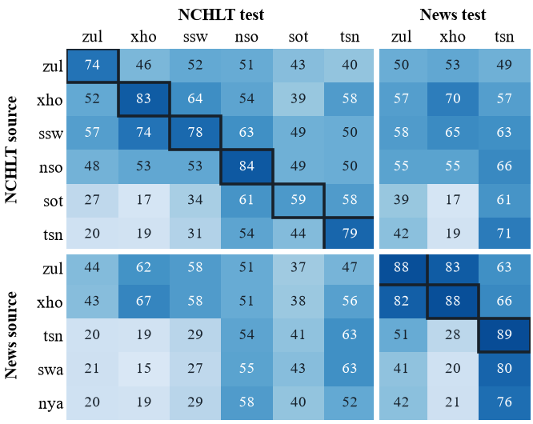

# Language, Domain, or Pretraining Exposure? Cross-Lingual NER for South African Bantu Languages

**COS802 Natural Language Processing project, University of Pretoria, 2026.** Mpendulo Sibeko (u19144832).

Choosing the source language is the main design decision in zero-shot cross-lingual named entity recognition (NER). This project fine-tunes **AfroXLMR-base** on one source at a time and tests it on six South African Bantu languages: isiZulu, isiXhosa and siSwati (Nguni), and Sepedi, Sesotho and Setswana (Sotho-Tswana). Swahili and Chichewa also serve as sources. It uses two corpora with different text domains and annotation guidelines, **NCHLT** (government text) and **MasakhaNER 2.0** (news). The result is 333 evaluations across 11 sources, 9 test sets and 3 seeds, plus few-shot runs.

**Final report:** [`report_final/19144832_Sibeko_COS802_Final_Report.pdf`](report_final/19144832_Sibeko_COS802_Final_Report.pdf)

## Research questions and findings

| | Question | Verdict |
|---|---|---|
| **RQ1** | Does linguistic relatedness or domain match better predict zero-shot transfer? | Relatedness is the most consistent predictor: +0.10 transfer ratio per step, p < .001. Corpus match can override it: a sister language from the target's corpus beats the same language from the other corpus by **32.0 F1** on isiZulu news and **12.7 F1** on isiXhosa news (Holm p = .005). |
| **RQ2** | Do targets seen in pretraining transfer better? | No advantage was found, but exposure is confounded with language cluster and tokenizer fertility, so this is inconclusive. |
| **RQ3** | How far do 100 and 500 target sentences close transfer gaps? | 500 sentences close **57–89%** of every gap. Most of the gain comes by 100 sentences only for the weakest starting points. |
| **RQ4** | Are Sepedi and Sesotho better Setswana sources than Swahili and Chichewa? | **Reversed:** Swahili is ahead by 13.0–19.0 F1, and the gap stays with equal entity counts. |



## Repository

```
.
├── report_final/    Final report: LaTeX sources, PDF, and the scripts that draw every figure
├── notebooks/       COS802_Experiment.ipynb, the full experiment (Google Colab, T4 GPU)
├── results/         Verified numbers behind the report, follow-up results and run logs
└── presentation/    7-slide deck and the script that builds it
```

## Reproduce

1. **Experiments.** Open `notebooks/COS802_Experiment.ipynb` in Google Colab with a GPU runtime and run it from top to bottom. The notebook downloads both datasets, trains every model and writes the results, which are mirrored to Google Drive. Finished runs are skipped when you resume.
2. **Figures.**

   ```bash
   cd report_final && python figures/make_heatmap.py && python figures/make_figures.py
   ```

3. **Report.**

   ```bash
   cd report_final && latexmk -pdf main.tex
   ```

Python packages: `torch`, `transformers`, `datasets`, `seqeval`, `statsmodels`, `pandas`, `matplotlib`, `python-pptx`, `Pillow`.

## Data and licences

The datasets are not stored in this repository; the notebook downloads them. **NCHLT NER** (SADiLaR) is licensed CC BY 2.5 ZA, and **MasakhaNER 2.0** is licensed CC BY-NC 4.0. The model is [`Davlan/afro-xlmr-base`](https://huggingface.co/Davlan/afro-xlmr-base).
